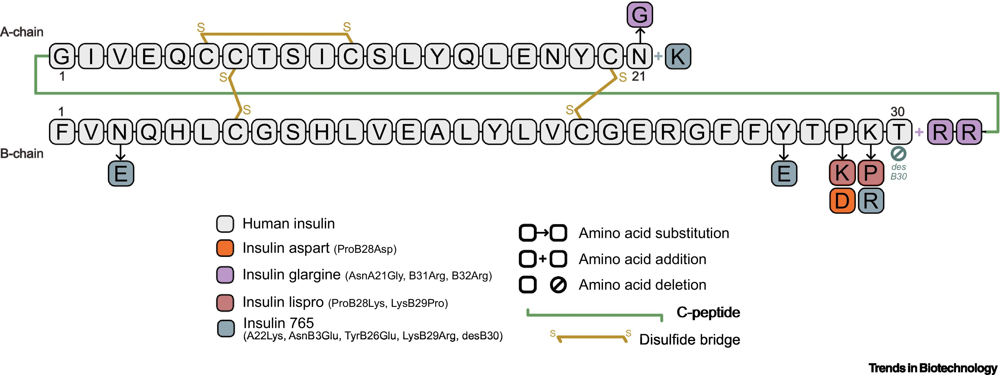
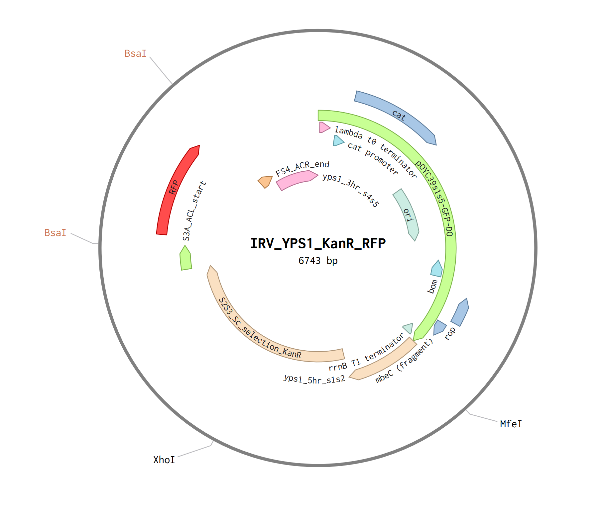
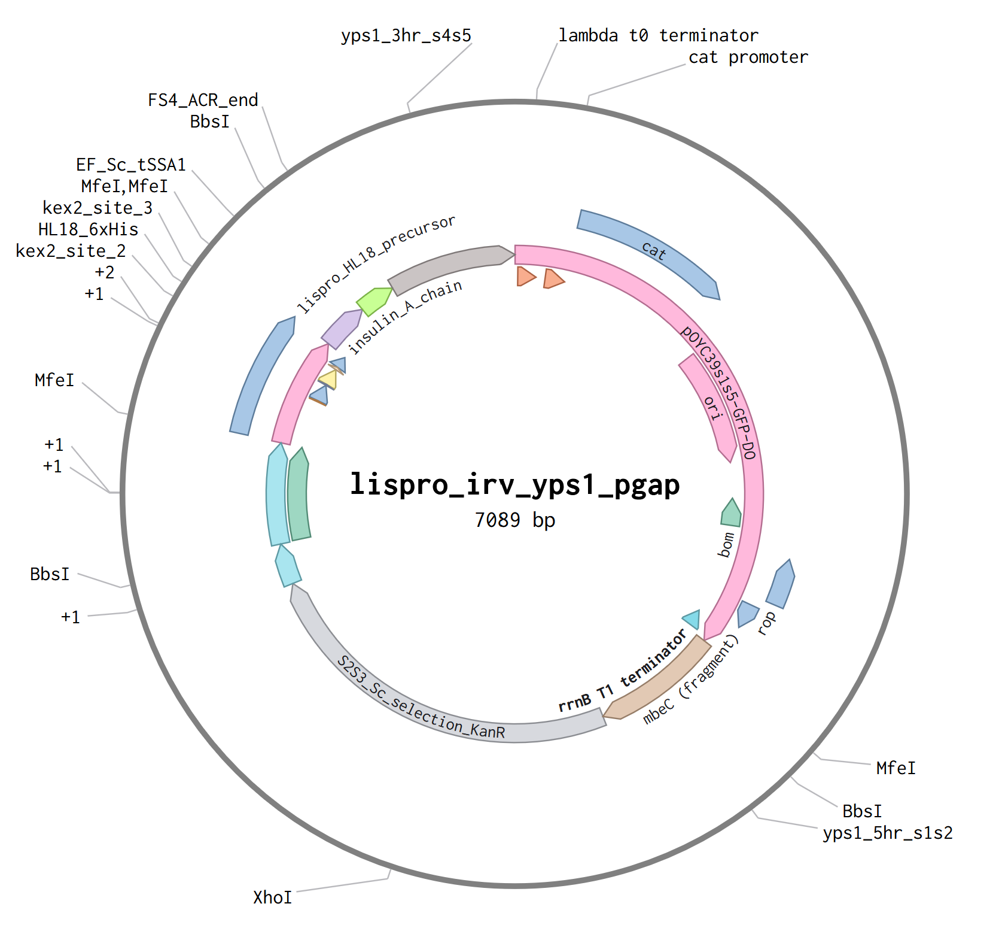

# Editing System
 I'm choosing HR because it is the simplest choice, and it worked for the PN1 -> PN2 transformation. I believe the low efficiency can be overcome with the Kanamycin selection marker.  Crispr or knocking out KU70 to force the yeast to choose HR over NHEJ are other possible avenues. 
##### References
 * [Genome Editing Systems Across Yeast Species](https://pmc.ncbi.nlm.nih.gov/articles/PMC7744358/)

# Loci

| Name | Notes                                                                                                                                                                                                                                                                                                     |
| ---- | --------------------------------------------------------------------------------------------------------------------------------------------------------------------------------------------------------------------------------------------------------------------------------------------------------- |
| YPS1 | - protease KO candidate - yapsin 1 protease - likely to attack lispro as its being secreted - Might be more effective in combination with PEP4 - Likely relevant regardless of the promoter used - Yps1 may play a role in alpha factor cleaving, but it seems like KEX2 is the primary gene. |
| PEP4 | - protease KO candidate - proteinase A, proteinase B, carboxypeptidase Y - PEP4 gene secretes vacuolar proteases into the broth - SMD1168 (pep4Δ) and SMD1163 (pep4Δ prb1Δ) - possibly more relevant if we use the AOX1 promoter                                                              |
| AOX1 | "standard" locus for the AOX1 promoter                                                                                                                                                                                                                                                                    |
| PRB1 | ?                                                                                                                                                                                                                                                                                                         |

##### References
* [Disruption of YPS1 and PEP4 genes reduces proteolytic degradation of secreted HSA/PTH in Pichia pastoris GS115](https://academic.oup.com/jimb/article/40/6/589/5994886)
* [Handbook of Proteolytic Enzymes - Yapsin 1](https://www.sciencedirect.com/science/chapter/edited-volume/abs/pii/B9780120796113500410)
* [Yield improvement of heterologous peptides expressed in _yps1_-disrupted _Saccharomyces cerevisiae_ strains](https://www.sciencedirect.com/science/article/abs/pii/S0141022900001587)
* [Gleeson et al. 1998](https://www.researchgate.net/publication/13603766_Generation_of_Protease-Deficient_Strains_and_Their_Use_in_Heterologous_Protein_Expression)

# CDS

## AA Precursor Sequence

| segment                | indices | length | sequence                                                           |
| ---------------------- | ------- | ------ | ------------------------------------------------------------------ |
| α-factor pre           | 1-19    | 19     | `MRFPSIFTAVLFAASSALA`                                              |
| α-factor pro           | 20-83   | 64     | `APVNTTTEDETAQIPAEAVIGYSDLEGDFDVAVLPFSNSTNNGLLFINTTIASIAAKEEGVSLE` |
| Kex2 site              | 84-85   | 2      | `KR`                                                               |
| lispro B chain B1-B30  | 86-115  | 30     | `FVNQHLCGSHLVEALYLVCGERGFFYTKPT`                                   |
| Kex2 site              | 116-117 | 2      | `KR`                                                               |
| HL18 + 6xHis           | 118-147 | 30     | `SVEDEDGDDEYATEETLSHHHHHHGDDDDK`                                   |
| spacer                 | 148-150 | 3      | `GAA`                                                              |
| Kex2                   | 151-152 | 2      | `KR`                                                               |
| insulin A chain A1-A21 | 153-173 | 21     | `GIVEQCCTSICSLYQLENYCN`                                            |
| stop                   | 174     |        | `TAA`                                                              |
##### Processing
1. signal peptidase cuts pre in ER
2. Kex2 cuts first two `KR` sites in the golgi
3. A+HL18 and B+`KR` chains form disulfide bonds
4. Molecule is secreted
5. Purification
6. HL18 is removed with Kex2 in vitro. B chain retains `KR`

##### References
* [Yeast secretory expression of insulin precursors](https://doi.org/10.1007/s002530000402)
* HL18 fusion [Functional expression of recombinant insulins in Saccharomyces cerevisiae](https://link.springer.com/content/pdf/10.1186/s12934-024-02571-2.pdf)
* [Molecular engineering of insulin for recombinant expression in yeast](https://www.sciencedirect.com/science/article/pii/S016777992300286X)

## Promoter

| Name  | Notes                                                                                                                          |
| ----- | ------------------------------------------------------------------------------------------------------------------------------ |
| AOX1p | - requires methanol which could be hard to work with or acquire - commonly used (e.g. OpenInsulin) Biocon                   |
| GAPp  | - Constitutive promoter, can be tested in the shake flask - Seems like it would be easier for testing, worse for production |

# Purification

#### Gel & Dye
* Spin to clear the both
* concentrate and/or use TCA and/or acetone to precipitate the proteins
* run a gel specialized for small molecules with coomassie dye
* compare to ladder and off the shelf insulin and wild type on supernatant

#### Imac

##### References
[^Kim]: [Functional expression of recombinant insulins in Saccharomyces cerevisiae](https://link.springer.com/content/pdf/10.1186/s12934-024-02571-2.pdf)

##### Materials

# Assembly

##### References
* https://experiment.com/u/HXePMQ

# Roadmap

### 1. Amplify Custom Homology Arms
Only planning to create arms for YPS1 to start. We can still use the AOX parts from the OYC. 
Each custom locus will require 3 custom primers to be ordered: 2 for the arm synthesis + syntax overhangs and 1 additional one further along the genome to verify integration. YPS1: 3, Aox: 1. 4 primers needed.

##### Process
1. Follow the 1st protocol [^MIMB1] to prep the gDNA. It looks like it will be suitable for the homology arms because the authors were able to PCR amplify a 4394 bp segment which is much larger than the planned homology arms.
2. Use synthesized primers to amplify homology arms targeting the genes in [[#Loci]] with the syntax referenced in [[#Assembly]].
	1. 600 bp on each arm
	2. 5' `FN392322.1:1158169-1158768`
	3. 3' `FN392322.1:1160569-1161168`
3. Gel/column purification

##### References
[^MIMB1]: [Isolation of _Pichia pastoris_ Genomic DNA for Long-Read DNA Sequencing and PCR Applications](https://doi.org/10.1007/978-1-0716-4779-0_3)

##### Materials
* [Lumiprobe DNA Purification Columns](https://www.lumiprobe.com/p/nap-10-dna-purification-columns)

### 2. Test YPS1 Arms

| slot  | part                     | source           | plasmid | released piece |
| ----- | ------------------------ | ---------------- | ------- | -------------- |
| s5→s1 | `pOYC39s1s5-GFP-DO`      | backbone         | 3367 bp | 2516 bp        |
| s1→s2 | `yps1_5hr_s1s2`          | PCR from PN gDNA | 635 bp  | 604 bp         |
| s2→s3 | `S2S3_Sc_selection_KanR` | OYC B12          | 3883 bp | 1764 bp        |
| s3→A  | `S3A_ACL_start`          | OYC A5           | 2318 bp | 195 bp         |
| A→F   | `AF_RFP_Dropout`         | pTiR             | 5484 bp | 886 bp         |
| F→s4  | `FS4_ACR_end`            | OYC G9           | 2311 bp | 174 bp         |
| s4→s5 | `yps1_3hr_s4s5`          | PCR from PN gDNA | 635 bp  | 604 bp         |
| —     | **product**              |                  | **6743 bp** | **4227 bp** |

##### Process
1. grow up & miniprep parts in bugs
	1. select using cat
2. quant parts & perform BsaI reaction
3. store in bug again for storage/save point
	1. GFP marker should disappear with the dropout replaced
4. miniprep, use primers and high fidelity polymerase to dial out the linear integrative sequence. use 2 primers from step 1
5. perform HR
	1. validate with primers from step 1
	2. select with kanamycin
	3. look for RFP

### 3. Test lispro part

| slot  | part                     | source           | plasmid | released piece |
| ----- | ------------------------ | ---------------- | ------- | -------------- |
| s5→s1 | `pOYC39s1s5-GFP-DO`      | backbone         | 3367 bp | 2516 bp        |
| s1→s2 | `yps1_5hr_s1s2`          | PCR from PN gDNA | 635 bp  | 604 bp         |
| s2→s3 | `S2S3_Sc_selection_KanR` | OYC B12          | 3883 bp | 1764 bp        |
| s3→A  | `S3A_ACL_start`          | OYC A5           | 2318 bp | 195 bp         |
| A→C   | `ab_kp_pgap_ac`          | OYC E2 + PCR     | 508 bp  | 481 bp         |
| C→E   | `lispro_hl18_ce`         | custom           | 550 bp  | 523 bp         |
| E→F   | `EF_Sc_tSSA1`            | OYC H8           | 2354 bp | 228 bp         |
| F→s4  | `FS4_ACR_end`            | OYC G9           | 2311 bp | 174 bp         |
| s4→s5 | `yps1_3hr_s4s5`          | PCR from PN gDNA | 635 bp  | 604 bp         |
| —     | **product**              |                  | **7089 bp** | **4573 bp** |

The A→C part will not come fram the plasmid

I think I can't use the BbsI dropout reaction because the RFP TU contains internal BbsI sites, but maybe there's a more convenient RFP part available. If not, the lispro test IRV can be assembled from scratch in another BsaI reaction.
Plan to order `lispro_hl18_ce` in a bug. can dial out with PCR or maybe use BsaI

The two KP promoters will need to be re-leveled since they are currently A-B parts and we need A-C. This will require 2 primers each.
6 additional primers.

##### Verification
* Sanger the IRV
* do as many of the purification and detection steps as it takes to prove something went wrong
### 4. Experiment with promoters and loci
Rinse and repeat with every combination of pGAP, pAOX, YPS1 arms, AOX arms, mismatched arms

### 5. Rebuild with floxable kanr part

Eventually we'll want to remove the KanR so there's no problems with producing a therapeutic. I think it's possible to add lox sites to the stock OYC part with PCR as well but I don't fully understand how.
### 6. Scale
Assuming all goes to plan, build a bioreactor and figure out how to produce and purify at scale :).
